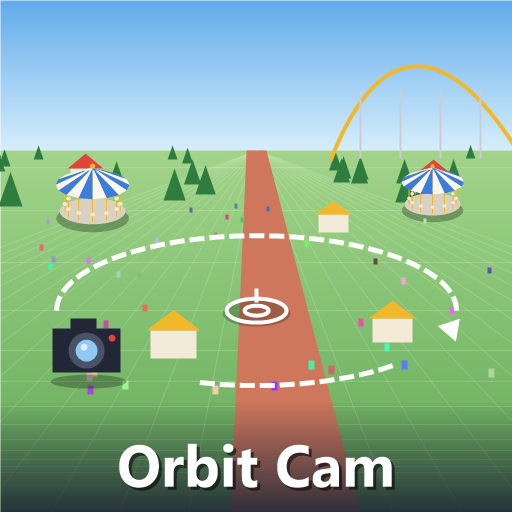

# Orbit Cam

A free orbiting camera for [Parkitect](https://www.themeparkitect.com/): tilt it down to the ground or up to the sky, orbit around anything, and zoom from the treetops down to a guest's shoulder.

[Steam Workshop page](https://steamcommunity.com/sharedfiles/filedetails/?id=3838167836)

Orbit Cam continues [Perspective Camera](https://steamcommunity.com/sharedfiles/filedetails/?id=1291489658) by H-POPS ([source](https://github.com/H-POPS/Parkitect_PerspectiveCamera)), with fixes and new features on top. It uses its own identifier (`xupisco@OrbitCam`), so **disable Perspective Camera when using Orbit Cam**.



## Controls

- The camera keys (**WASD**) move, **Q** and **E** rotate, **R** and **F** tilt, and the mouse wheel zooms.
- Hold the **middle mouse button** to orbit, with **Shift** to pan.
- **Shift + mouse wheel** changes how fast the camera keys move it.
- **F10** switches between Orbit Cam and the game's own camera.

## What's new since Perspective Camera

- **The cursor stays put while orbiting**, so whatever you are building doesn't jump to the middle of the screen.
- **Map view**: the game's map view key (**M**) turns the view straight down, lined up with the park's grid. Q and E turn it a quarter at a time, the middle mouse button drags the map, and M or Esc take you back to the angle you had.
- **Sound by distance**: rides and speakers are heard by how far they are from you, not by whether they are on screen. Anything up to as far as the spot you look at plays as in the game, with the game's own mix by zoom; only what lies beyond fades.
- Floating labels no longer appear in the sky when what they point at is behind the camera.
- The outline of what you hover works right after switching cameras.
- Gentler panning with the middle mouse button.
- A middle mouse drag that starts over a window doesn't turn the camera, for windows that use that button themselves, such as [PiP Cam](https://steamcommunity.com/sharedfiles/filedetails/?id=3835355172)'s views.

## Building

You need the .NET SDK and Parkitect installed.

```bash
dotnet build PerspectiveCamera/BetterPerspective.csproj -c Release
```

The build copies the mod, Harmony, the license and the preview into `Documents/Parkitect/Mods/orbit_cam`. If the game or your Parkitect user folder is somewhere else:

```bash
dotnet build PerspectiveCamera/BetterPerspective.csproj -c Release -p:ParkitectPath="<Parkitect>" -p:ParkitectUserPath="<Documents>/Parkitect"
```

## Credits

Based on Perspective Camera by Henrico Pops (H-POPS), ParkitectNexus. The sound patch uses [Harmony](https://github.com/pardeike/Harmony) (MIT), which is bundled with the mod.

## License

[MIT](LICENSE), keeping the original copyright.
